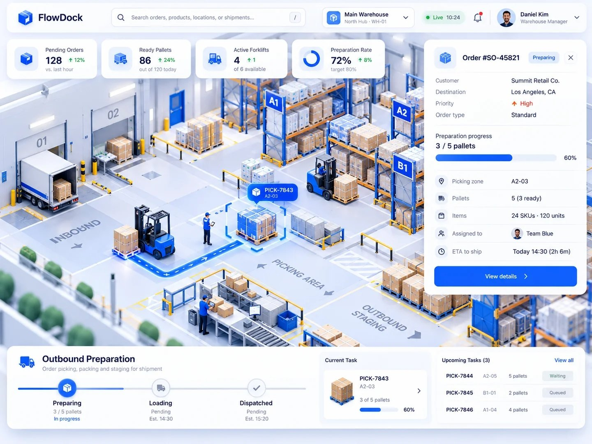

# threejs-3d

three.js で、倉庫オペレーションのアイソメトリック 3D シーンにダッシュボード UI を重ねた学習用プロジェクト。



## 動かし方

```bash
npm install
npm run dev
```

ブラウザで表示された URL（既定は `http://localhost:5173/`）を開く。

## できること

- フォークリフトがピック位置から出荷待機エリアへパレットを運び、進捗と KPI が更新される
- 3D のパレット、または下部の Upcoming Tasks をクリックすると、注文詳細が切り替わりカメラが移動する
- 検索欄（`/` キーで移動）に ID・ゾーン・顧客名を入れて Enter で選択する
- 左下の Reference ボタンで `sample.jpg` を重ねて見比べる
- ドラッグで回転、右ドラッグでパン、ホイールでズーム

## 構成

```text
index.html            UI のマークアップ
src/main.js           3D・シミュレーション・UI をつなぐエントリーポイント
src/data.js           タスクと KPI の初期データ
src/sim.js            担当フォークリフトの運搬シミュレーション
src/ui.js             UI の描画と操作
src/style.css         UI のスタイル
src/scene/stage.js    レンダラー・カメラ・ライト・OrbitControls
src/scene/warehouse.js 倉庫のレイアウト
src/scene/props.js    ラック・パレット・フォークリフトなどの部品
src/scene/markers.js  経路の帯・選択枠・ラベル
src/scene/textures.js Canvas で作るテクスチャ
docs/spec.md          仕様
```

仕様の詳細は [docs/spec.md](./docs/spec.md) を参照。
