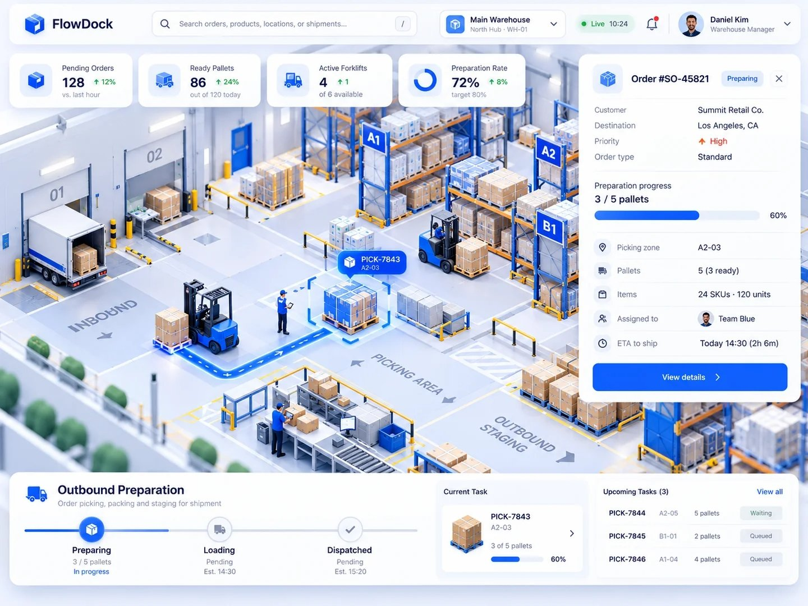

# 倉庫オペレーション 3D ダッシュボード 仕様

## 背景

参考ポスト（[X のポスト](https://x.com/ClaudeCode_love/status/2116677851651146183)）は、アイソメトリックな 3D シーンの上にダッシュボード UI を重ねた表現を題材にしている。
ポスト本文は取得できなかったため、同じ方向性の UI 画像である `sample.jpg` を一次資料として仕様を決める。



## 目的

- three.js の基本（シーン・カメラ・ライト・影・ジオメトリ・マテリアル・InstancedMesh・Raycaster・CSS2DRenderer）を一通り使う
- 3D シーンと HTML の UI を同じ状態から描画し、片方の操作がもう片方に反映される構成を作る

## 技術構成

| 項目 | 採用 |
| --- | --- |
| ビルド | Vite 6 |
| 3D | three.js 0.170（npm） |
| 言語 | JavaScript（ES Modules） |
| UI | 素の HTML / CSS（フレームワークなし） |

## 画面構成

```text
┌ ヘッダー：ロゴ / 検索 / 倉庫切替 / Live 時計 / 通知 / ユーザー ┐
│ KPI カード ×4                              │ 注文詳細パネル │
│                                            │               │
│        3D シーン（全面・UI の背面）         │               │
│                                            │               │
└ 下部パネル：出荷準備ステップ / 現在のタスク / 次のタスク一覧 ┘
```

- 3D シーンは画面全体に描画し、UI パネルはその上に重ねる
- 注文詳細パネルで隠れる分だけ、カメラの描画中心を左へずらす（`setViewOffset`）

## 3D シーン

### カメラと操作

- `OrthographicCamera` で斜め上から見下ろすアイソメトリック風の画角にする
- `OrbitControls` で回転・ズーム・パンを許可し、回転角とズーム倍率に上限を設ける
- タスクを選ぶと、カメラの注視点を対象のパレットへなめらかに移動する

### 倉庫のレイアウト

| 区画 | 内容 |
| --- | --- |
| 入荷（INBOUND） | 左壁のドック 01・02、トラック、パレット |
| ラック A1・A2・B1 | 青い支柱とオレンジの梁、各段にパレットと段ボール |
| ピッキングエリア | タスクごとのピック対象パレット、作業員 |
| 梱包 | 作業台・モニター・コンベヤー（箱が流れる） |
| 出荷待機（OUTBOUND STAGING） | フォークリフトが運んだパレットを並べる |

- 床の文字（INBOUND など）は Canvas で描いた文字を貼った平面で表す
- ラックに積む大量の箱とパレットは `InstancedMesh` でまとめて描画する

### 動き

- 担当フォークリフトが、ピック位置 → 出荷待機エリアへパレットを 1 枚ずつ運ぶ
- 運び終えるたびに、タスクの準備済みパレット数と KPI の Ready Pallets が増える
- タスクの全パレットを運ぶと次のタスクへ移り、全タスクを終えると最初に戻る
- 別のフォークリフトがラック通路を巡回し、梱包コンベヤーの箱が流れる
- 担当フォークリフトの経路は、流れる矢印付きの青い帯で床に表示する
- 選択中のパレットには、脈打つ青い四隅の枠とラベル（例：PICK-7843 / A2-03）を付ける

## UI

| 部品 | 内容 |
| --- | --- |
| KPI カード | Pending Orders / Ready Pallets / Active Forklifts / Preparation Rate |
| 注文詳細 | 顧客・配送先・優先度・準備進捗・ピッキングゾーン・担当・出荷予定 |
| 出荷準備ステップ | Preparing → Loading → Dispatched |
| 現在のタスク | 進行中のピッキングタスクと進捗 |
| 次のタスク | 待機中のタスク一覧（クリックで選択） |

## 操作

| 操作 | 結果 |
| --- | --- |
| 3D のパレットにカーソルを重ねる | ラベルを表示する |
| 3D のパレットをクリックする | そのタスクを選択し、注文詳細を切り替える |
| タスク一覧の行をクリックする | 同上。カメラが対象へ移動する |
| 検索欄で ID やゾーンを入力して Enter | 一致した最初のタスクを選択する |
| `/` キー | 検索欄へフォーカスする |
| 注文詳細の × | パネルを閉じる（パレット選択で再表示） |
| 右下の参照ボタン | `sample.jpg` を半透明で重ねて見比べる |

## 対象外

- 実データとの接続（データは `src/data.js` の固定値とシミュレーション）
- フォークリフト同士の衝突回避
- ダークモード
